# MyYanga v4 — Functionality Architecture & Platform Capabilities

**The best of African fashion creativity, in one spot.**

MyYanga is the portal where lovers of African fashion discover, engage and patronize African creatives — designers, photographers, makeup artists and fabric makers. Version 4 is the pre-production release: monetizable end-to-end, with AI Virtual Wear from a **paid brand pool**, member Settings for identity + reel scheduling, multi-parameter Smart Search, competitions, editorial programming, anonymized analytics with brand Insights, and a full admin console with delegated rights.

Prepared: July 2026 · ZonicMe Limited · Abuja · Lagos · Diaspora  
Hostile audit: **80 pass / 0 fail — 100/100 — SHIP** (`npm run audit:aggressive`)

---

## 1. Product Vision

> Discover African creatives. Engage with their work. Patronize them directly. See yourself in their fashion before you buy — and let fashion reels find you on *your* schedule.

MyYanga connects three audiences:

- **Fashion lovers** — browse editorial spotlights, shop looks, try garments virtually from promoted brands, receive curated reels, enter competitions, share looks with friends.
- **African creatives / brands** — pay into promotion to appear on Discover and rotate into Virtual Wear; gain credibility-ranked storefronts and direct patronage (WhatsApp, Instagram, shop).
- **Platform operator (ZonicMe)** — every feature free or paid, priced from Admin; payments across Flutterwave → Paystack → Stripe; analytics without selling raw PII.

### User advantages (why members stay)

| Advantage | How MyYanga delivers it |
|-----------|-------------------------|
| See yourself before you buy | Virtual Wear: photo → His/Hers + event theme + outfit type → randomized look from paid brands; no outfit repeat until the pool cycles |
| Control when fashion finds you | Settings: channels (inbox / email / push / WhatsApp), cadence, preferred days, local time, timezone, quiet hours |
| One search, many dimensions | Smart Search: His/Hers + country, event, style, colour, piece, price band — every tick narrows together |
| Patronize creatives directly | Discover promoted pool with equal WhatsApp / Instagram / Virtual Wear / Shop actions |
| Privacy-respecting analytics | Site events are anonymized; member profile details are never sold as raw PII in analytics |
| Sign in the way Africa actually signs in | Google default; WhatsApp OTP secondary (Meta Cloud API, **no BSP**); email tertiary |

---

## 2. Visual walkthrough

### 2.1 Home — brand-first entry

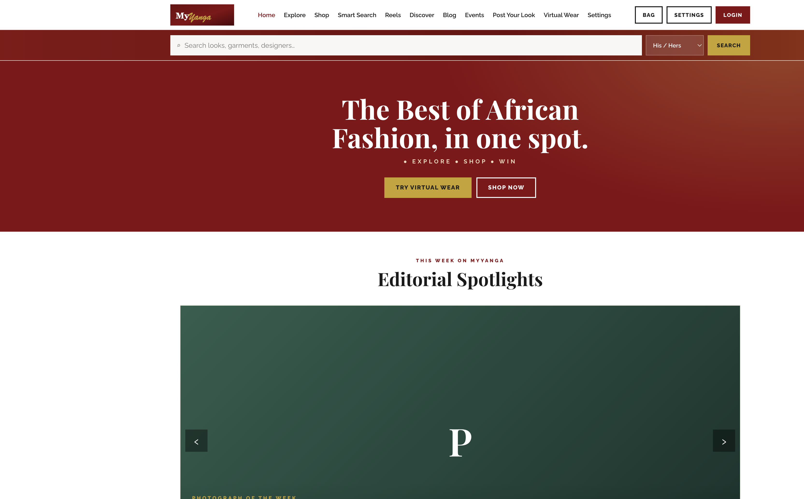

Hero CTA pair: **Try Virtual Wear** and **Shop now**. Sticky header exposes Settings beside Login. Editorial spotlights and category rails follow.

### 2.2 Settings — identity + notification reel schedule (sleek member hub)

**Your MyYanga** is a two-panel composition:

**Left — Profile / About you**

- Display name, email, WhatsApp/mobile, city, country  
- Fashion preference (Hers / His / none)  
- Short style note (occasions, diaspora sizing)  
- Save profile · optional Sign in for cloud sync  

**Right — Notification reels / When fashion lands**

- Channel tiles: In-app inbox · Email · Web push · WhatsApp  
- Cadence: Daily · Weekly · Every 2 weeks  
- Preferred days (Mon–Sun chips)  
- Preferred time + timezone (Africa/Lagos default; Accra, Johannesburg, London, New York)  
- Quiet hours start/end  
- Save reel schedule · Open Reels inbox  

Copy states the business model clearly: *brands in the paid pool fund the inventory; the member controls the clock.*

Empty / first-visit chrome (same layout, placeholders):

### 2.3 Virtual Wear — paid pool rotator

Three-step flow: **1. Photo → 2. Theme & outfit type → 3. Your look**.

Member copy: upload a photo, choose event theme and outfit type; the app dresses them from brands that **paid into the Virtual Wear pool**. Looks are randomized; the same outfit does not return until the matching pool is exhausted.

### 2.4 Discover — promoted brand pool

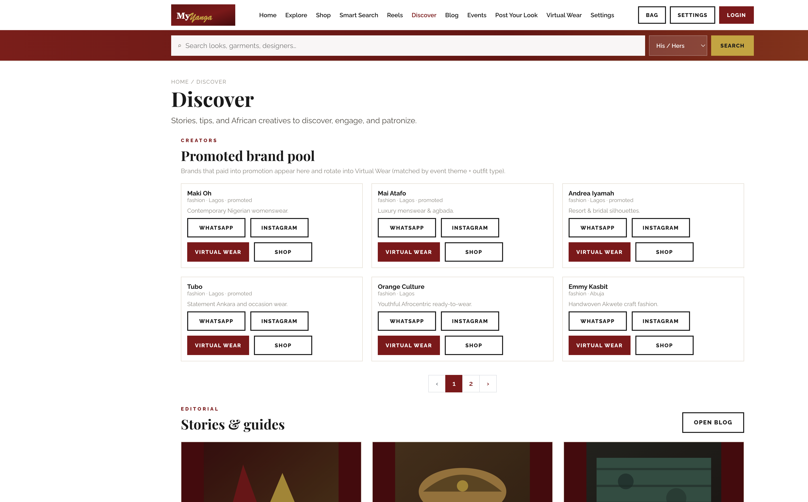

Creators with `is_promoted` appear here and rotate into Virtual Wear (matched by gender + event theme + outfit type). Each card exposes equal actions: WhatsApp, Instagram, Virtual Wear, Shop.

### 2.5 Reels inbox — delivery surface

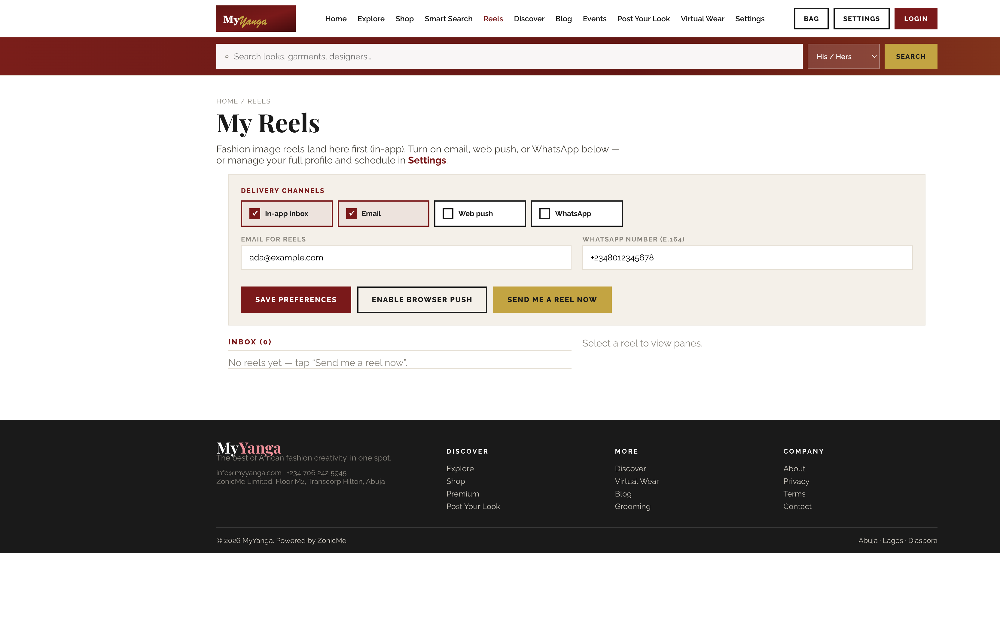

In-app inbox is the always-on destination. Quick channel toggles live here; full schedule and profile live in **Settings** (linked from the page lead).

### 2.6 Smart Search — multi-parameter discovery

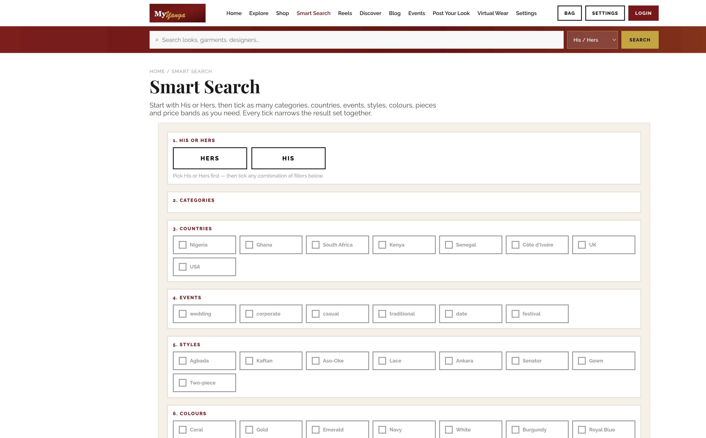

Start with His or Hers, then tick countries, events, styles, colours, pieces and price bands. Returns garments and assembled look decks (brand, per-item cost, total).

### 2.7 Sign-in — Google default, WhatsApp secondary

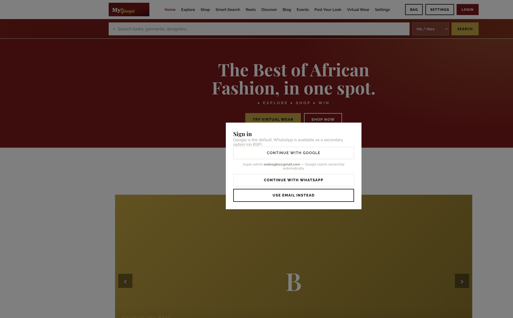

Continue with Google (primary) · Continue with WhatsApp (no BSP) · Use email instead. Founding Google address claims super admin automatically.

### 2.8 Blog — acquisition funnel

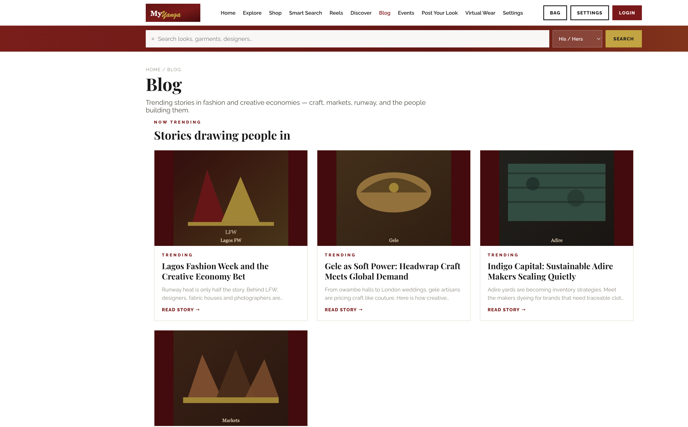

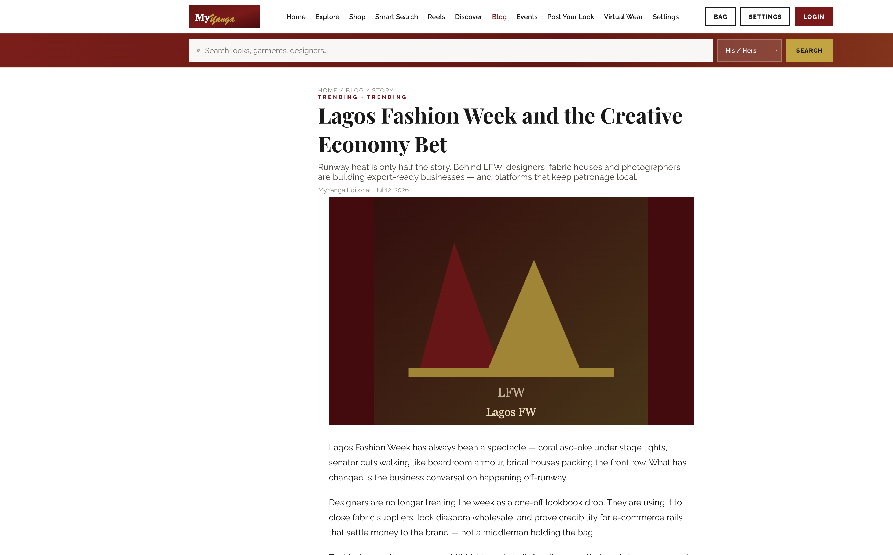

Index teasers → article with share + guest comments + **Explore MyYanga** CTA.

### 2.9 Bag & PDP

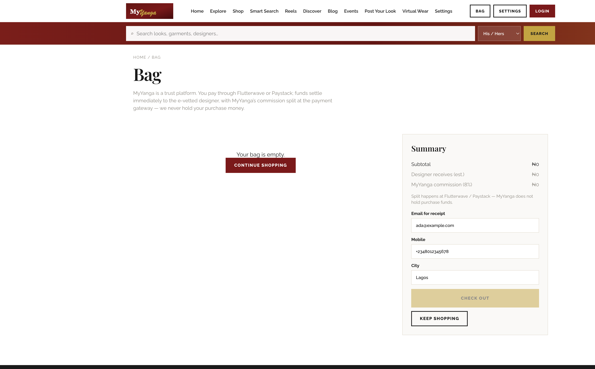

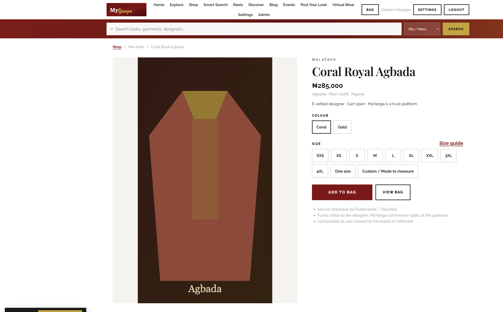

Apple-minimal PDP; Bag with designer split preview. Add to Bag only for e-vetted brands.

### 2.10 Admin surfaces (operator)

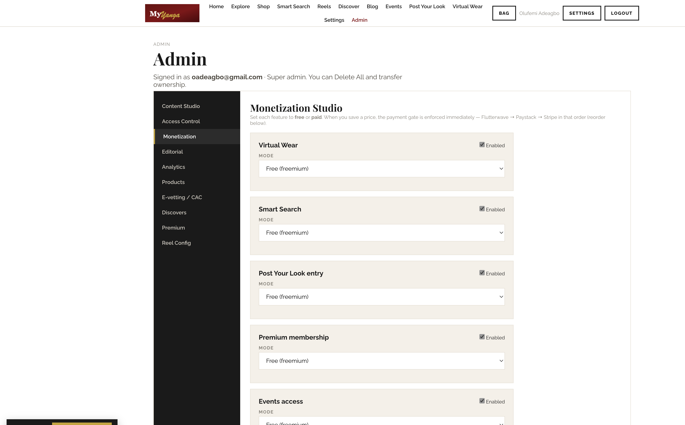

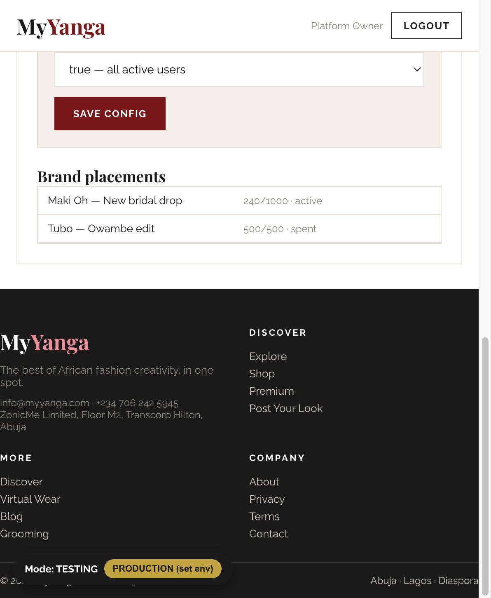

---

## 3. Feature catalogue

### 3.1 Discovery & editorial

| Feature | What it does |
|---------|--------------|
| Editorial carousel | Outfit of the Day, Bride/Groom/Couple of the Week, Photograph / Fabric / Makeup / Designer in Focus — admin-published |
| **Blog** | Acquisition funnel: nav **Blog**, home + Discover teasers (title, 2-line excerpt, thumbnail) → article with share + guest comments + **Explore MyYanga** CTA back to home |
| Discover | Stories & guides (wired to Blog articles) + **promoted brand pool** (`is_promoted`) |
| Explore & Shop | Category browse and shoppable product grid |
| Events | Fashion events with venue, city, schedule; optionally pay-gated |

### 3.2 Virtual Wear (AI try-on) — paid brand pool

1. Member uploads a photo  
2. Chooses **His/Hers**, **event theme** (wedding, owambe, corporate, traditional, date, casual, …) and **outfit type** (Agbada, Gown, Ankara, …)  
3. App picks a **random** `main_outfit` from brands with **`is_promoted`** (paid Virtual Wear / Discover promotion), matching gender + event tag + style  
4. Same outfit is **never repeated** for that wearer until the matching pool is exhausted (then recycles) — local no-repeat store (`vwPool.js`)  
5. Optional same-brand accessories; Gemini AI render with on-device canvas fallback  

Monetization gate: `creator_promotion` → labelled **Virtual Wear + Discover promotion**. Brands pay to be in the pool; members experience fair rotation, not a designer picker.

### 3.3 Shop — PDP, Bag & trust checkout

MyYanga is a **trust platform**, not the merchant of record holding purchase money.

| Piece | Behaviour |
|-------|-----------|
| Catalog → PDP | Apple-minimal layout; Selfridges-complete colour + size matrix + size guide |
| E-vetting gate | **Add to Bag** only when brand is `is_e_vetted` (Admin → E-vetting / CAC) |
| Bag | Sparse summary, qty, designer split preview, email/city |
| Settlement | Flutterwave multi-subaccount split (or Paystack single-brand); **commission % at gateway** |
| Trust | Funds settle to the designer immediately; MyYanga commission is gateway-split — we never hold the bag total |
| Testing | Mock settle records a local order and clears the bag |

Feature-gate payments (Virtual Wear unlock, Smart Search, …) stay separate from retail checkout.

#### Brand e-vetting (CAC) — unlocks cart

Privilege: **`brand_e_vetting`** (Access Control). Admin opens **Admin → E-vetting / CAC**:

1. Open CAC portal / search brand RC  
2. Paste listing → **Snap listing into form** (legal name, RC, address, director, TIN)  
3. Complete contacts, socials, adverse-media / scandals notes  
4. Upload director **ID shot**  
5. Tick **CAC verified** + **scandals cleared**  
6. **Approve e-vet + unlock cart** → sets `is_e_vetted` + `is_promoted`; Flutterwave subaccount required for live settlement  

Minimums enforced in UI before approve. Schema: migration `009` (commerce) + `010` (CAC dossier columns).

### 3.4 Member Settings (profile + reel clock)

| Area | Controls | Persistence |
|------|----------|-------------|
| Profile | Name, email, phone, city, country, fashion preference, bio | `myyanga_member_settings` (Testing); cloud profile when signed in |
| Channels | In-app, email, web push, WhatsApp | `myyanga_reel_prefs` |
| Schedule | Frequency, days, time_local, timezone, quiet_start / quiet_end | Nested under reel prefs |
| Actions | Save profile, save schedule, enable push, open Reels | Analytics: `settings_save_profile`, `REEL_CHANNEL` |

**Business effect:** delivery inventory is brand-funded; attention timing is member-owned — higher engagement, lower fatigue, clearer monetization story for paid pool brands.

### 3.5 Notification reels

Configurable image reels: in-app inbox (live), email (Resend-ready), web push, WhatsApp queue + `wa.me` / Meta Cloud (no BSP). Admin Reel Config meters brand ad slots. Member schedule in Settings gates *when* delivery is appropriate.

### 3.6 Look sharing & competitions

- Share / download generated looks; public `/look/{code}` with guest comments (RLS)  
- Post Your Look: votes via `vote_pyl`; entry optionally gated (`pyl_entry`)
- Blog articles: `/?view=blog` index + `/?view=article&slug=…`; Web Share / copy link; guest comments via `blog_comments` (migration `011`) or Testing `localStorage`

### 3.7 Monetization — freemium per feature

| Gate | Feature |
|------|---------|
| `virtual_wear` | Virtual try-on |
| `smart_search` | SmartSearch AI |
| `pyl_entry` | Competition entry |
| `premium` | Premium membership |
| `events` | Event access |
| `creator_promotion` | Paid placement in Discover + VW pool |
| `retail_checkout` | Marketplace bag (gateway split — not an entitlement gate) |

Providers cascade: **Flutterwave → Paystack → Stripe**. Feature entitlements verified on return and webhooks. Retail uses the same providers with **subaccount split**.

### 3.8 Analytics & Insights

- Anonymized autocapture + fashion-granular events (`analytics.js`, migration `008`)  
- Admin Analytics + Insights studio; brand-scoped keys via `creators.id`  
- Orbit export path for monetized brand reporting  

See also: `docs/FASHION_ANALYTICS.md`.

---

## 4. Administration & governance

| Studio | Purpose |
|--------|---------|
| Content Studio | Page copy/media, garment uploads in Testing |
| Access Control | Directory, privileges, co-owners, transfer, audit |
| Monetization | Per-feature free/paid + provider order |
| Editorial | Carousel programming |
| Analytics / Insights | Site KPIs + fashion rollups + AI assistant |
| Catalog | Products, discovers, premium |
| E-vetting / CAC | Privilege `brand_e_vetting`: CAC snap, KYC dossier, promote, unlock cart + subaccounts |
| Reel Config | Reel structure + brand placements |

**Auth:** Google default · WhatsApp OTP secondary · email tertiary. Founding owner: `oadeagbo@gmail.com`. Rights mutations are SECURITY DEFINER RPCs with audit — UI is convenience, not the boundary.

---

## 5. Testing vs Production

| | Testing (default) | Production |
|--|-------------------|------------|
| Data | Seeded mocks + localStorage uploads | Supabase Postgres + RLS |
| Auth | Google / WhatsApp / email; founding = owner; testers get Admin Studio | DB roles; WhatsApp via `auth-whatsapp` edge |
| Pay gates | All free | Live gates + payments |
| Retail cart | Mock Flutterwave split settle | Live subaccount split via payments edge |
| Virtual Wear | Canvas compositing | Gemini + canvas fallback |
| Settings / reels | Local prefs + inbox | Same UX; cloud sync when signed in |

---

## 6. Technical architecture

### 6.1 Stack

| Layer | Technology |
|-------|------------|
| Frontend | React 18 + Vite 5, bespoke design system (Playfair / Raleway, maroon–gold–cream) |
| Backend | Supabase: Postgres + RLS, Auth, Storage, Edge Functions (Deno) |
| Payments | Flutterwave, Paystack, Stripe |
| AI | Gemini 2.5 Flash Image (try-on), Anthropic Claude (stylist / insights) |
| Hosting | Static `dist/` + Supabase data plane |

### 6.2 Client seams (selected)

- `src/myyanga-app.jsx` — shell, routing (`view=` + `/look/:code` + blog/article slugs), design system, admin  
- `src/pages/BlogPage.jsx` + `src/lib/blogPosts.js` + `src/lib/blogComments.js` — editorial acquisition blog  
- `src/pages/SettingsPage.jsx` — sleek profile + reel schedule  
- `src/pages/VirtualWearPage.jsx` + `src/lib/vwPool.js` — paid pool rotator + no-repeat  
- `src/lib/memberSettings.js`, `reelStore.js`, `reelEngine.js` — prefs + delivery  
- `src/lib/analytics.js` — anonymized events  
- `src/lib/dataBridge.js` — testing ⇄ production  
- `src/lib/accessControl.js`, `monetization.js`, `virtualWear.js`, `smartSearch.js`

### 6.3 Database & edge

Migrations `001`–`011` (core → access control → analytics → commerce → e-vetting → blog). Edge: `payments`, `smart-search`, `virtual-tryon`, `ai-chat`, `send-reel`, `auth-whatsapp` — JWT + server-side gate checks.

### 6.4 Security posture

- Production roles only in DB; no client role map  
- Profiles RLS + safe public view; self-update cannot elevate ownership  
- Edge secrets never in client; no demo passwords in production UI  
- Typed confirmation for delete-all and super-admin transfer  

### 6.5 Quality gates

- `npm run verify:production`  
- `npm run audit:aggressive` — **80/80 — SHIP** (covers VW pool, Settings, analytics, WhatsApp auth, payments, blog funnel, footer legal pages, business/features docs, build)  
- `npm run package:staging`  
- `npm run docs:pdf` — regenerates this document as PDF with embedded screenshots  

### 6.6 Gemini cost guidance (pass-through to brands)

Model `gemini-2.5-flash-image` ≈ **$0.039/image** + input ≈ **₦54–85/render** at ~₦1,380/USD. Recommended pool pass-back: on the order of **₦125,000 per 1,000 successful AI renders**. Canvas fallback is free when AI is unavailable (not a quality substitute for Gemini).

---

## 7. Deployment runbook (summary)

1. `supabase db push` (migrations through analytics)  
2. Secrets: payment providers, `GOOGLE_API_KEY`, `ANTHROPIC_API_KEY`, `PUBLIC_APP_URL`, optional `RESEND_API_KEY`, WhatsApp Cloud token + phone number id — see `docs/AWS_SECRETS_RUNBOOK.md`  
3. `npm run sb:deploy`  
4. Enable Google Auth; deploy `auth-whatsapp` for secondary OTP  
5. `npm run build` → deploy `dist/` with SPA fallback for `/look/*`  
6. First Google login as founding email → configure monetization, editorial, promotion seats  

Footer Company links (About / Privacy / Terms / Contact) and Grooming resolve to in-app legal placeholders (`LegalPage.jsx`) — never 404. 

---

## 8. Known v4 limits & roadmap

- Shop catalog browse + **PDP / Bag / Flutterwave split checkout** for e-vetted brands (trust model — MyYanga does not hold purchase funds; commission splits at the gateway)  
- **Blog** acquisition funnel shipped (seeded fashion / creative-economy stories, share, comments, Explore MyYanga); production CMS admin for `blog_posts` still thin vs editorial carousel studio  
- Seeded garment art is placeholder until real photography is loaded via Content Studio  
- Webhook signature verification should be deepened before high volume  
- Reel email / push / WhatsApp Cloud need production secrets; dedicated SIM alone cannot automate WhatsApp  

---

## 9. Screenshot index

| File | Section |
|------|---------|
| `assets/myyanga-home.png` | Home hero |
| `assets/myyanga-settings-filled.png` | Settings profile + schedule (filled) |
| `assets/myyanga-settings.png` | Settings chrome |
| `assets/myyanga-virtualwear.png` | VW photo step / paid pool copy |
| `assets/myyanga-discover.png` | Promoted brand pool |
| `assets/myyanga-reels.png` | Reels inbox + channels |
| `assets/myyanga-smartsearch-results.png` | Smart Search |
| `assets/myyanga-blog.png` | Blog index |
| `assets/myyanga-article.png` | Blog article |
| `assets/myyanga-bag.png` | Bag |
| `assets/myyanga-pdp.png` | Product detail |
| `assets/myyanga-login.png` | Auth modal |
| `assets/myyanga-admin.png` | Admin |
| `assets/myyanga-evetting.png` | E-vetting / CAC |
| `assets/myyanga-accesscontrol.png` | Access Control |
| `assets/myyanga-monetization.png` | Monetization |
| `assets/myyanga-reelconfig2.png` | Reel Config |

Capture refresh: `npm run build && node scripts/capture-architecture-shots.mjs && node scripts/build-architecture-html.mjs`. Secrets: `docs/AWS_SECRETS_RUNBOOK.md`. Business: `docs/MYYANGA_BUSINESS_PLAN.md`. Tech matrix: `docs/FEATURES_AND_IMPLEMENTATION.md`.

---

*Prepared for ZonicMe Limited — MyYanga v4 functionality architecture. Confidential.*
